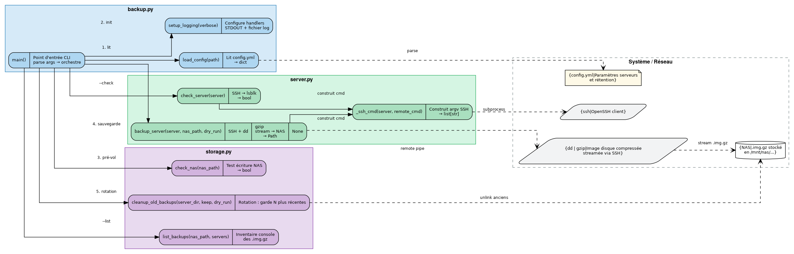
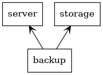

Structure UML
=============

Diagramme modules et appels de fonctions
-----------------------------------------

Vue complète des modules, fonctions et de leurs interactions avec les
ressources système (SSH, NAS, fichier de configuration).

**Lecture du diagramme :**

- **Bleu** — module ``backup.py`` (orchestrateur / point d'entrée CLI)
- **Vert** — module ``server.py`` (connexion SSH, imagerie disque)
- **Violet** — module ``storage.py`` (gestion NAS, rotation)
- **Gris pointillé** — ressources externes (OpenSSH, ``dd|gzip``, NAS, ``config.yml``)
- Flèches pleines → appels entre fonctions
- Flèches pointillées → interactions avec les ressources système

Diagramme de dépendances entre packages
-----------------------------------------

Dépendances d'import entre les trois modules Python.

``backup`` importe ``server`` et ``storage`` ; ``server`` et ``storage``
sont indépendants l'un de l'autre.

Régénérer les diagrammes
-------------------------

.. code-block:: bash

    # Diagramme de packages (pyreverse + graphviz)
    uvx --from pylint pyreverse -o dot -p sauvegardes \
        --output-directory docs/_static/uml backup.py server.py storage.py
    dot -Tpng docs/_static/uml/packages_sauvegardes.dot \
        -o docs/_static/uml/packages_sauvegardes.png

    # Diagramme modules/fonctions (source : docs/_static/uml/modules_fonctions.dot)
    dot -Tpng docs/_static/uml/modules_fonctions.dot \
        -o docs/_static/uml/modules_fonctions.png

    # Rebuild HTML
    uvx --with sphinx-rtd-theme --with sphinx-autodoc-typehints --with pyyaml \
        --from sphinx sphinx-build -b html docs docs/_build/html
